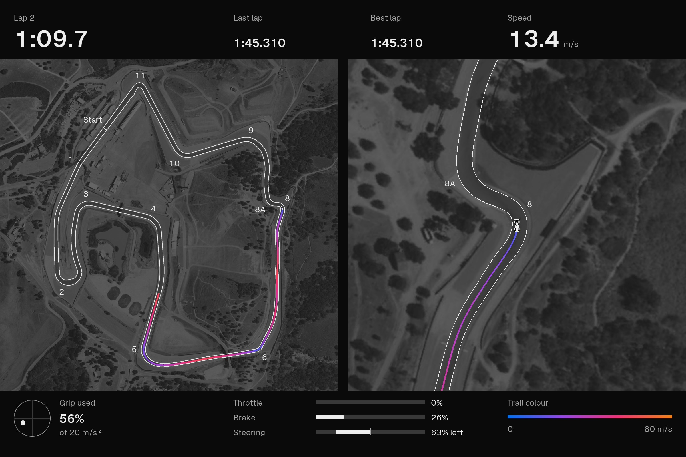

# racer-rl

Train your racer agent to achieve fastest lap times!

<p align="center">
  
</p>


## Setup

Install [uv](https://docs.astral.sh/uv/), then:

```bash
uv sync
```

Open the notebook and pick the `.venv` kernel by whatever IDE you prefer, or run:

```bash
uv run --with jupyter jupyter lab assignment.ipynb
```

To get a feel for the car, drive it yourself with the arrow keys:

```bash
uv run python scripts/drive.py
```


## Credits

Written in [JAX](https://docs.jax.dev). 

## License

Distributed under the [GNU General Public License v3](LICENSE).

Copyright (C) 2026 Deemo Chen, except `src/racer_rl/bellmax.py`, which is
Copyright (C) 2026 Max Muchen Sun.
